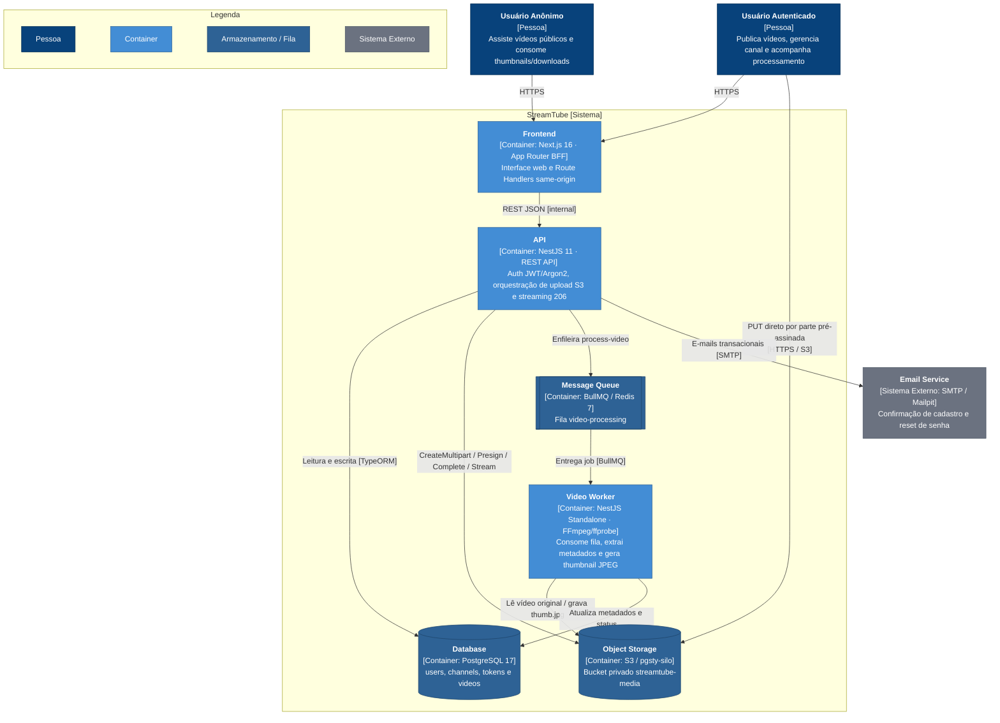

# StreamTube

Plataforma de compartilhamento e streaming de vídeos com upload direto para object storage S3, processamento assíncrono de mídia em worker dedicado e entrega por HTTP Byte-Range (`206 Partial Content`).

O backend é construído em NestJS 11 com PostgreSQL 17, Redis/BullMQ, storage compatível com S3 (`pgsty/silo` / MinIO em ambiente local) e `ffmpeg`/`ffprobe` para extração de metadados e geração de thumbnail. O frontend utiliza Next.js 16 (App Router) no padrão BFF, mantendo toda comunicação com a API isolada em Route Handlers server-side.

---

## Arquitetura

Diagrama de containers no modelo [C4](https://c4model.com/) (arquivo fonte também em [docs/diagrams/software-arch.mermaid](./docs/diagrams/software-arch.mermaid)).



### Fluxo de ingestão, processamento e entrega de mídia

```mermaid
sequenceDiagram
    participant C as Cliente
    participant API as API (NestJS)
    participant DB as PostgreSQL
    participant S3 as Object Storage (S3)
    participant Q as BullMQ (Redis)
    participant W as Video Worker (FFmpeg)

    C->>API: POST /videos/uploads/initiate
    API->>DB: Cria registro draft + shortCode único (11 chars)
    API->>S3: CreateMultipartUpload
    API-->>C: videoId, shortCode, uploadId

    loop Para cada parte (10 MiB padrão, até 10 GiB total)
        C->>API: POST /videos/:id/uploads/parts
        API-->>C: URL pré-assinada de UploadPart
        C->>S3: PUT parte direto no storage (sem passar pela API)
    end

    opt Cliente perdeu os ETags (reload, queda de conexão)
        C->>API: GET /videos/:id/uploads/parts
        API-->>C: Partes já armazenadas + ETags (retomada)
    end

    C->>API: POST /videos/:id/uploads/complete (ETags)
    API->>DB: Reserva draft -> processing (UPDATE condicional; perdedor recebe 409)
    API->>S3: CompleteMultipartUpload + HeadObject
    API->>Q: Enfileira job process-video (falha -> failed)
    API-->>C: 202 / status processing

    Q->>W: Entrega job process-video
    W->>S3: ffprobe/ffmpeg leem o original por URL GET pré-assinada (sem baixar o arquivo inteiro)
    W->>W: ffprobe (duração, codec, resolução) + ffmpeg (thumb.jpg), demuxer forçado pelo MIME declarado
    W->>S3: PutObject thumbnails/{channelId}/{videoId}/thumb.jpg
    W->>DB: Atualiza status processing -> ready (ou failed)

    C->>API: GET /videos/:shortCode/stream (Range: bytes=...)
    API->>S3: GetObject com Range
    API-->>C: 206 Partial Content + Content-Range + Accept-Ranges + ETag (404 se não estiver ready)
```

---

## Decisões de engenharia e arquitetura

As decisões da plataforma estão formalizadas em [docs/decisions/technical-decisions-phase-03-videos.md](./docs/decisions/technical-decisions-phase-03-videos.md). Os pontos centrais da arquitetura atual:

1. **Upload multipart direto para S3 (`VideosUploadService`)** — Arquivos de até **10 GiB** (`10737418240` bytes, partes padrão de `10 MiB`) nunca trafegam pelo processo Node.js da API. A API apenas valida permissões/MIME (`video/mp4`, `video/webm`, `video/quicktime`, `video/x-matroska`), cria o vídeo em estado `draft` e assina URLs `PUT` por parte diretamente contra o bucket privado `streamtube-media` (`videos/{channelId}/{videoId}/original.{ext}`).
2. **Identificador público compacto (`shortCode`)** — Gerado com `crypto.randomBytes(8).toString('base64url')` (11 caracteres URL-safe) em [short-code.util.ts](./nestjs-project/src/videos/short-code.util.ts), respaldado por índice `UNIQUE` em `videos.short_code` e retry em colisão (`23505`) no [VideosUploadService](./nestjs-project/src/videos/videos-upload.service.ts).
3. **Fila BullMQ/Redis com worker isolado (`video-worker`)** — Processamento de vídeo (`ffmpeg`/`ffprobe`) é CPU/I/O-bound e roda em container separado ([worker.main.ts](./nestjs-project/src/worker.main.ts) / [WorkerModule](./nestjs-project/src/worker.module.ts)) consumindo a fila `video-processing` com backoff exponencial. A versão `@nestjs/bullmq@^11.0.5` foi fixada intencionalmente no lugar da `12.x` (ESM-only) para preservar compatibilidade CJS na suíte Jest.
4. **Execução nativa de `ffmpeg`/`ffprobe` sem wrappers** — [MediaProcessorService](./nestjs-project/src/videos/media-processor.service.ts) invoca os binários nativos via `child_process.execFile` (sem `fluent-ffmpeg`), extraindo `durationSeconds`, `width`, `height`, `codec` e thumbnail JPEG em `min(1s, duração/2)` (com fallback para o primeiro quadro). O demuxer é forçado a partir do MIME declarado no upload (`mov` para mp4/quicktime, `matroska` para webm/mkv), com whitelist de protocolo: imagem enviada como vídeo é recusada e uma playlist HLS disfarçada de `.mp4` não faz o worker buscar URLs (SSRF). Erros das ferramentas vão para `processingError` sem a URL pré-assinada.
5. **Streaming proxy com suporte a `Range` (`206 Partial Content`)** — [VideosService](./nestjs-project/src/videos/videos.service.ts) mantém o bucket S3 privado e entrega `/videos/:shortCode/stream` via streaming proxy com `Accept-Ranges: bytes`, `Content-Range`, `206 Partial Content` e validação `416 Range Not Satisfiable`. Essa escolha evita expor URLs pré-assinadas atreladas ao hostname interno da rede Docker (`minio:9000`) e centraliza o controle de acesso a vídeos não publicados (`draft`/`processing`/`failed`), que nas rotas públicas respondem `404`, como um shortCode inexistente. As respostas de mídia passam por `sendMedia()` ([videos-http.util.ts](./nestjs-project/src/videos/videos-http.util.ts)): `HEAD` sem abrir o storage, `ETag` com `304`, `416` com `Content-Range: bytes */tamanho`, stream aberto só quando necessário e destruído se o cliente sair, `pipeline()` em vez de `pipe()` e `Content-Disposition` RFC 6266 (nome em UTF-8 com fallback ASCII).
6. **Conclusão de upload à prova de concorrência** — `POST /videos/:id/uploads/complete` reserva o vídeo com `UPDATE ... WHERE status = 'draft'` antes de tocar no S3: de duas chamadas simultâneas, só uma segue (a outra recebe `409`). Partes rejeitadas pelo S3 devolvem o vídeo para `draft` (o multipart continua aberto e o cliente pode tentar de novo). Depois que o S3 fecha o multipart, falha no `HeadObject`, objeto acima do limite ou falha ao enfileirar marcam `failed` com o motivo em `processingError`, em vez de deixar o vídeo em `processing` sem job.
7. **Storage local com `pgsty/silo`** — Como a imagem oficial `minio/minio` no Docker Hub passou a retornar `pull access denied`, o [compose.yaml](./nestjs-project/compose.yaml) utiliza `pgsty/silo` (fork comunitário S3-compatível drop-in), fixado na tag `RELEASE.2026-11-12T00-00-00Z`, com `S3_FORCE_PATH_STYLE=true`.
8. **Worker que não deixa vídeo preso e limites de abuso** — o `video-worker` roda `node` direto (sem `npm run` como PID 1), então `docker compose stop` entrega SIGTERM ao Nest e o BullMQ termina o job ativo. Job falho por travamento (`UnrecoverableError`) marca `failed` mesmo com tentativas restantes. Uma varredura a cada 15 min ([VideoMaintenanceService](./nestjs-project/src/videos/video-maintenance.service.ts), agendada pelo BullMQ) aborta drafts abandonados há mais de 24 h e marca `failed` vídeos em `processing` sem job vivo há mais de 30 min. O `initiate` tem throttle (10/min) e cada canal pode ter até 5 drafts abertos.

---

## Pré-requisitos

- Docker e Docker Compose v2
- Node.js v25+ e npm (necessário no host apenas para testes E2E Playwright do frontend)

---

## Como rodar

As stacks de backend e frontend possuem arquivos `compose.yaml` independentes. Suba primeiro o backend e rode as migrations.

### 1. Backend (API + Worker + PostgreSQL + Mailpit + S3 Storage + Redis)

```bash
cd nestjs-project

# Crie o .env local caso ainda não exista
cp .env.example .env

# Sobe api, video-worker, db, mailpit, minio (pgsty/silo) e redis
docker compose up -d

# Instala dependências (apenas na primeira subida). O video-worker sobe antes
# do node_modules existir e reinicia sozinho (restart: unless-stopped) até conseguir.
docker compose exec nestjs-api npm install

# Executa as migrations (synchronize está desabilitado)
docker compose exec nestjs-api npm run migration:run

# Sobe a API em watch mode
docker compose exec -d nestjs-api npm run start:dev
```

> Ao testar upload multipart diretamente do host (`curl` ou browser), defina `S3_PUBLIC_ENDPOINT=http://localhost:9000` no `.env` para que as URLs pré-assinadas retornadas por `POST /videos/:id/uploads/parts` resolvam fora da rede interna do Docker. Volte para vazio antes de rodar os testes: as suítes rodam dentro do container `nestjs-api`, onde `localhost:9000` não é o storage.

Serviços disponíveis:

| Serviço | Endpoint / Porta | Observação |
|---|---|---|
| API NestJS | `http://localhost:3000` | Swagger opcional em `/api/docs` com `SWAGGER_ENABLED=true` |
| Video Worker | Container `video-worker` | Consome a fila BullMQ `video-processing` |
| PostgreSQL 17 | `localhost:5432` | `streamtube` / `streamtube` |
| Object Storage (S3 / Console) | `http://localhost:9000` / `http://localhost:9001` | Credenciais dev: `minioadmin` / `minioadmin` |
| Redis 7 | `localhost:6379` | Backend de filas BullMQ |
| Mailpit (UI SMTP) | `http://localhost:8025` | Captura e-mails transacionais em dev |

### 2. Frontend (Next.js BFF)

```bash
cd next-frontend
docker compose up -d
docker compose exec next-frontend npm install        # apenas na primeira subida
docker compose exec -d next-frontend npm run dev
```

Interface disponível em `http://localhost:3001` (acessa a API no host via `host.docker.internal:3000`).

---

## Endpoints da API

### Vídeos — Upload, Processamento e Entrega

| Método e Rota | Autenticação | Responsabilidade |
|---|---|---|
| `POST /videos/uploads/initiate` | JWT (10/min, até 5 drafts abertos) | Cria registro `draft`, gera `shortCode` único e abre multipart upload no S3 |
| `POST /videos/:id/uploads/parts` | JWT (dono do canal) | Emite URL pré-assinada `PUT` para uma parte específica do arquivo |
| `GET /videos/:id/uploads/parts` | JWT (dono do canal) | Lista as partes já enviadas com ETags, para retomar o upload |
| `POST /videos/:id/uploads/complete` | JWT (dono do canal) | Conclui o multipart upload, valida objeto, muda para `processing` e enfileira job |
| `POST /videos/:id/uploads/abort` | JWT (dono do canal) | Aborta multipart upload no S3 e remove o registro `draft` |
| `GET /videos/me` | JWT | Lista vídeos do canal pertencente ao usuário autenticado |
| `GET /videos/:id/status` | JWT (dono do canal) | Retorna status atual, metadados extraídos e eventual `processingError` |
| `GET /videos/:shortCode` | Pública (`@Public()`) | Metadados públicos e URLs de stream, download e thumbnail (`404` enquanto não estiver `ready`) |
| `GET /videos/:shortCode/stream` | Pública (`@Public()`) | Entrega de mídia com suporte a HTTP `Range` (`206 Partial Content`) |
| `GET /videos/:shortCode/download` | Pública (`@Public()`) | Download completo com `Content-Disposition: attachment` |
| `GET /videos/:shortCode/thumbnail` | Pública (`@Public()`) | Thumbnail JPEG (`image/jpeg`) gerada pelo `video-worker` |

### Autenticação e Canais

| Método e Rota | Responsabilidade |
|---|---|
| `POST /auth/register` | Cadastro de usuário e criação automática de canal 1:1 |
| `GET /auth/confirm-email?token=` | Confirmação de e-mail via token único |
| `POST /auth/resend-confirmation` | Reenvio de token de confirmação |
| `POST /auth/login` | Autenticação (access + refresh token) |
| `POST /auth/refresh` | Rotação de refresh token com family tracking e detecção de reuso |
| `POST /auth/logout` | Revogação dos refresh tokens da sessão |
| `POST /auth/forgot-password` | Disparo de token de recuperação de senha |
| `POST /auth/reset-password` | Redefinição de senha |
| `GET /auth/me` | Perfil do usuário autenticado |

Especificação OpenAPI atualizada em [nestjs-project/openapi.json](./nestjs-project/openapi.json) (`npm run openapi:export`).

---

## Testes e Verificações

### Backend (`nestjs-project`)

```bash
cd nestjs-project
docker compose exec -T nestjs-api npm test                 # unitários + integração reais
docker compose exec -T nestjs-api npm run test:e2e          # end-to-end HTTP via Supertest
docker compose exec -T nestjs-api npx tsc --noEmit          # checagem estrita de tipos
docker compose exec -T nestjs-api npm run lint              # ESLint (0 erros, 0 warnings)
docker compose exec -T nestjs-api npm run build             # build da API e do worker
```

Os testes de integração e E2E do módulo de vídeos executam fluxos reais contra PostgreSQL, Redis, `pgsty/silo` (S3) e geração de MP4 com `ffmpeg`; apenas o envio SMTP (`MailService`) é mockado na suíte E2E. As suítes rodam em série (`maxWorkers: 1` nas duas configs do Jest, porque compartilham o banco) e usam o prefixo BullMQ `streamtube-test`, então o `video-worker` do Compose nunca pega job de teste.

### Frontend (`next-frontend`)

```bash
cd next-frontend
docker compose exec next-frontend npm test                  # Vitest + MSW
npx playwright test                                         # E2E no host (MSW_ENABLED=true)
```

---

## Estrutura do Repositório

```
.
├── docs/
│   ├── project-plan.md                        # Plano geral e escopo das entregas
│   ├── decisions/
│   │   └── technical-decisions-phase-03-videos.md
│   ├── diagrams/
│   │   └── software-arch.mermaid              # Diagrama C4 de containers
│   └── phases/
│       ├── phase-01-configuracao-base/
│       ├── phase-02-auth/
│       ├── phase-02-auth-frontend/
│       └── phase-03-videos/                   # Context, validation, library-refs, spec e progress
├── nestjs-project/
│   ├── src/
│   │   ├── auth/                              # JWT, Argon2, refresh rotation, throttler
│   │   ├── users/                             # Usuários
│   │   ├── channels/                          # Canais 1:1 por usuário
│   │   ├── mail/                              # Mailer + templates Handlebars
│   │   ├── storage/                           # S3StorageService (multipart, presign, byte-range)
│   │   ├── videos/                            # Upload, fila BullMQ, FFmpeg processor, streaming
│   │   ├── common/                            # DomainException, filtros e pipes
│   │   ├── config/                            # Schemas Joi e namespaces de configuração
│   │   ├── database/                          # DataSource e migrations TypeORM
│   │   ├── worker.main.ts                     # Bootstrap do video-worker
│   │   └── worker.module.ts                   # Módulo standalone do worker
│   ├── test/                                  # Suítes E2E
│   ├── compose.yaml
│   └── Dockerfile.dev                         # Node + FFmpeg/ffprobe
├── next-frontend/                             # App Router BFF, shadcn/ui, iron-session, Playwright
├── .agents/                                   # Skills, rules, sub-agents e exemplo de MCP (Antigravity)
├── .claude/                                   # Fundação equivalente para Claude Code
├── CLAUDE.md
├── GEMINI.md
├── FC Tube.fig
├── FC Tube sem padrão.fig
└── whiteboard.svg
```

---

## Engenharia Guiada por Especificação e Ferramental (Antigravity + Gemini 4 Hydrogen)

Para conduzir o desenvolvimento sem geração ad-hoc de código, o ciclo seguiu uma pipeline fechada de engenharia orientada a artefatos, portando a fundação operacional de `.claude/` (`skills/` e `rules/`) para a convenção nativa do **Google Antigravity** (`.agents/skills/`, `.agents/rules/`, [GEMINI.md](./GEMINI.md) e [nestjs-project/GEMINI.md](./nestjs-project/GEMINI.md)), com ambos os contextos mantidos em sincronia. As rules usam o frontmatter do Antigravity (`trigger: glob` + `globs:`; sem `trigger` válido ele as descarta em silêncio) e os sub-agents de leitura estão em `.agents/agents/`. Os servidores MCP do `.mcp.json` (Postgres) e o context7 vão no `mcp_config.json` do Antigravity, que é por usuário e fica fora do repositório; o equivalente versionado está em [.agents/mcp_config.example.json](./.agents/mcp_config.example.json). O MCP do Postgres conecta em `localhost:5432`: se houver um PostgreSQL nativo escutando nessa porta no host, ele responde no lugar do container `db`.

Como frente adicional de avaliação prática, toda a etapa de vídeos foi conduzida no **Antigravity** utilizando o modelo **Gemini 4 Hydrogen** (identificador `gemini-4-hydrogen-high` na sessão do Antigravity) para testar capacidade de raciocínio arquitetural, planejamento incremental e implementação verificável em ambiente multi-container:

1. **Research & ADRs** — Levantamento das opções de fila, storage multipart, ciclo de estados, worker e streaming proxy em [technical-decisions-phase-03-videos.md](./docs/decisions/technical-decisions-phase-03-videos.md).
2. **Contexto & Validação** — Mapeamento de impactos no código existente ([context.md](./docs/phases/phase-03-videos/context.md)) e auditoria prévia do plano até fechar limpo ([validation.md](./docs/phases/phase-03-videos/validation.md)).
3. **Resolução de dependências & Especificação** — Travamento de versões compatíveis ([library-refs.md](./docs/phases/phase-03-videos/library-refs.md)) e plano detalhado em 11 itens de implementação ([phase-03-videos.md](./docs/phases/phase-03-videos/phase-03-videos.md)).
4. **Implementação incremental & Rastreabilidade** — Entrega dos módulos, migrations, testes unitários/integração/E2E e registro em [progress.md](./docs/phases/phase-03-videos/progress.md), complementada por revisão em par (protocolo auditor/construtor com portão humano) em rodadas: na 1ª, o Claude Code auditou a entrega do Antigravity, reprovou (lint quebrado, MCP não portado) e escreveu as correções; na 2ª e na 3ª, o Antigravity auditou essas correções. Depois, uma revisão adversarial independente (Claude Fable 5.2) olhou o que as rodadas não cobriram; as correções dela foram feitas pelo Claude Code, um commit por achado, com teste de regressão antes de cada uma, e auditadas pelo Antigravity numa 4ª rodada antes do merge. Achados e correções: [progress.md](./docs/phases/phase-03-videos/progress.md) → *Post-review revisions* e *Final review revisions*.

---

## Roadmap das Entregas

| Módulo / Etapa | Escopo | Status |
|---|---|---|
| Base do Projeto | Monorepo Docker, NestJS 11, Next.js 16, TypeORM + PostgreSQL 17 | Concluída |
| Autenticação | Cadastro, confirmação SMTP, login, refresh rotation, reset de senha e BFF | Concluída |
| Upload e Processamento de Vídeos | Multipart S3 até 10 GiB, fila BullMQ/Redis, worker FFmpeg, thumbnail e streaming `206` | Concluída (Backend) |
| Gerenciamento de Vídeos e Canal | Edição de metadados, visibilidade e painel do canal | Planejada |
| Página de Visualização | Player integrado e página pública do vídeo | Planejada |
| Interações Sociais | Likes, comentários e inscrições | Planejada |
| Descoberta e Busca | Feed inicial, pesquisa e acabamento final | Planejada |

---

Repositório originado do template [devfullcycle/mba-ia-greenfield-project](https://github.com/devfullcycle/mba-ia-greenfield-project), onde constam o plano base e o design system (`FC Tube.fig`).
